# Intent Notes 2차 개선 시험 보고서 (PRD-Improve2 기준)

| 문서 버전 | 기준 PRD | 대상 | 시험 일 |
|---|---|---|---|
| v2.1 | `PRD-Improve2.md` v2.11 | https://my-blog-test-b439a.web.app (실제 배포 사이트) | 2026-11-25 |

**결론:** 44개 항목 중 **통과 36 · 부분 통과 4 · 실패 1 · 확인 못 함 3**. "AI는 제안만 하고 사람이 적용한다", "방문자가 읽을 때는 AI를 부르지 않는다"는 원칙은 지켜졌습니다. 남은 것은 점검 목록 갱신 지연(C8)과, 새 읽기 측정이 GA에 쌓이는지 확인하는 일입니다. 항목별 입력·기대값·결과값은 [부록 `Test-Improve2-Detail.md`](Test-Improve2-Detail.md)에 있습니다.

## 1. 전체 유저플로우 화면

**방문자:** 홈 → 메뉴별 목록 → 글 상세(AI 요약·추천·공유·댓글) → 소개·처리방침 → 없는 주소(404). **관리자:** 로그인 → 글 관리 → 글쓰기(AI 도우미) → 발행 전 점검 → 글 보기 → AI 이용 현황.

<table>
<tr>
<td align="center" width="20%">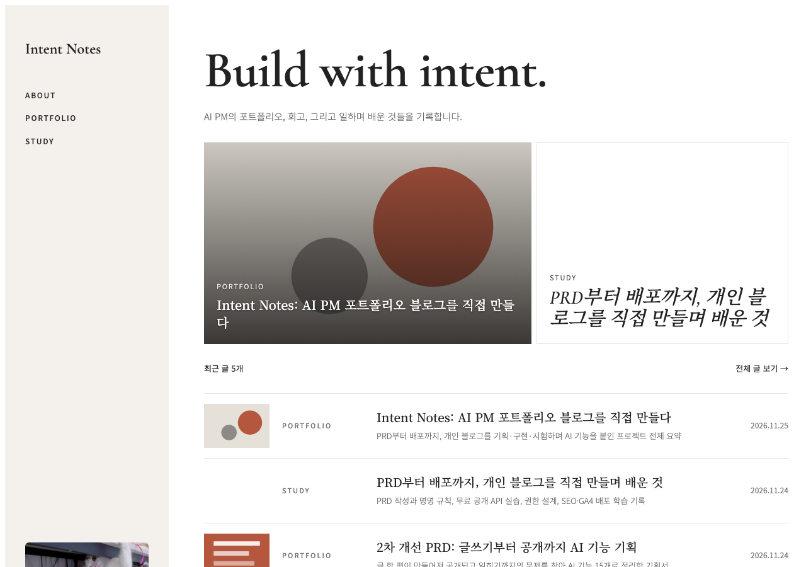 ① 홈</td>
<td align="center" width="20%">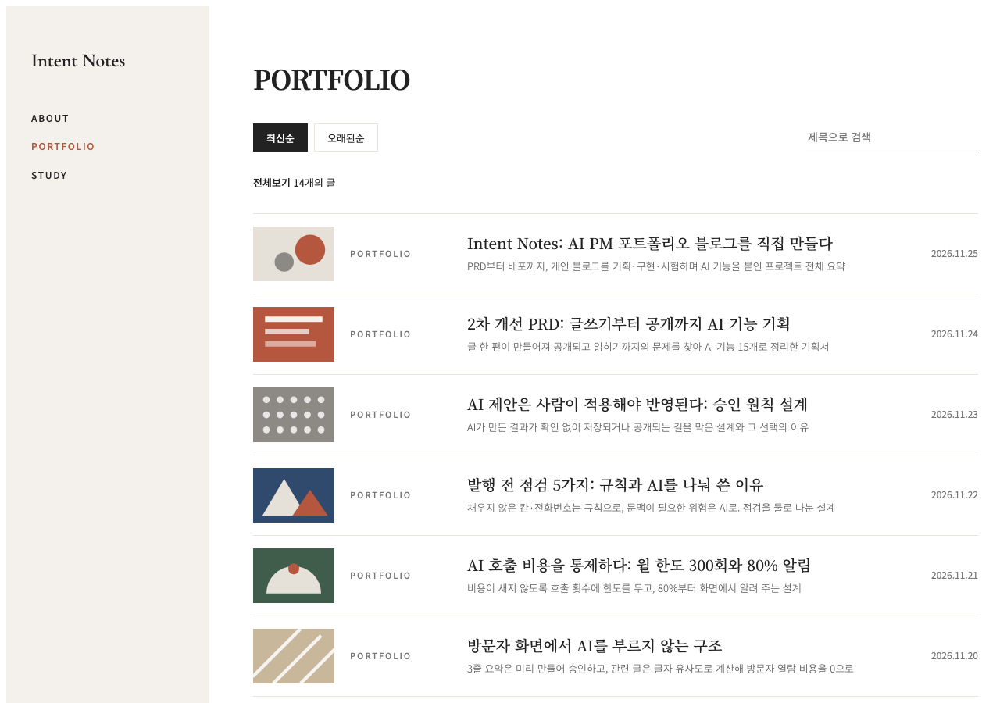 ② 목록</td>
<td align="center" width="20%">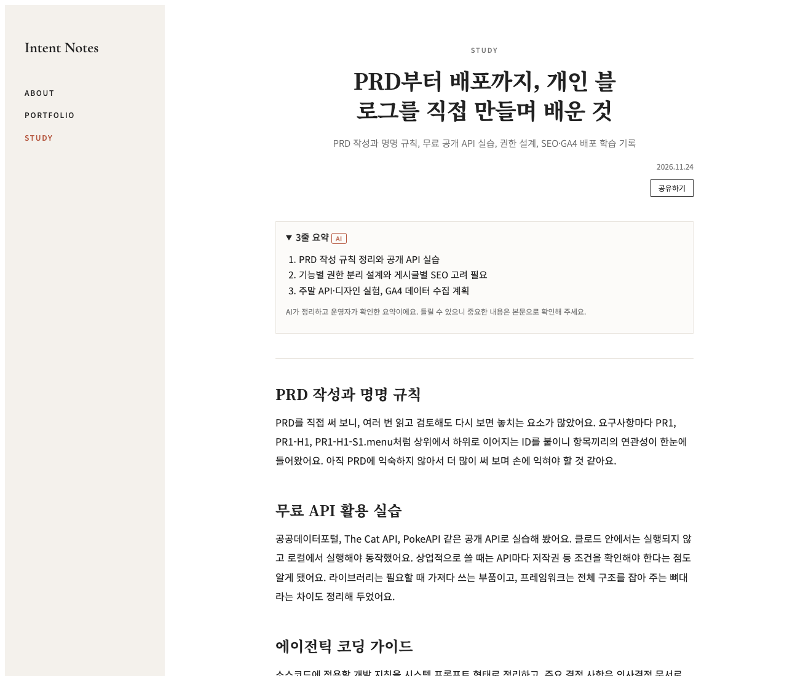 ③ 글 상세</td>
<td align="center" width="20%">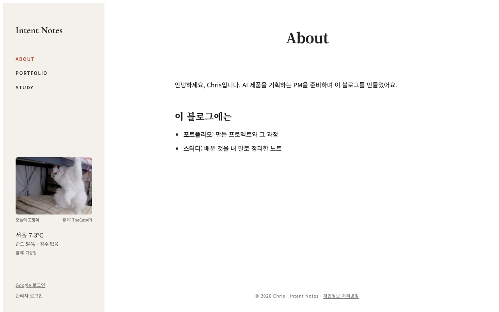 ④ 소개</td>
<td align="center" width="20%">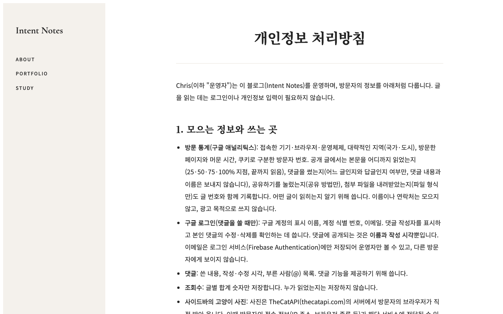 ⑤ 처리방침</td>
</tr>
<tr>
<td align="center" width="20%">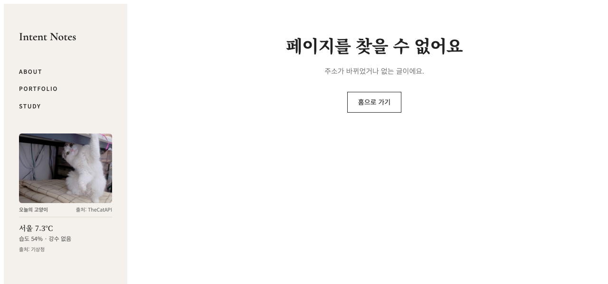 ⑥ 404</td>
<td align="center" width="20%">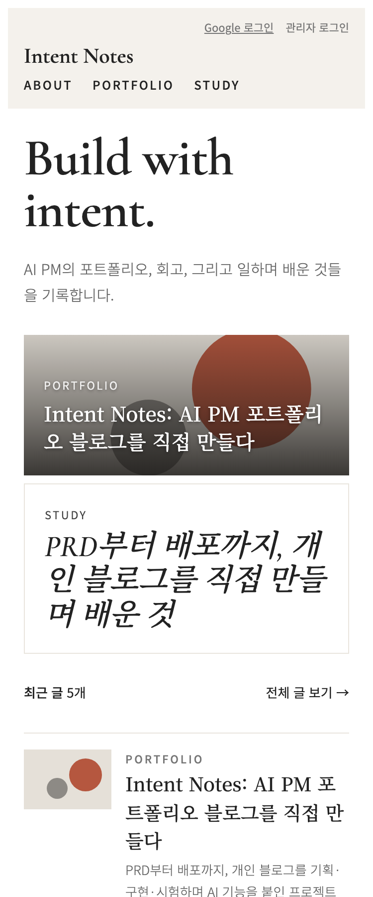 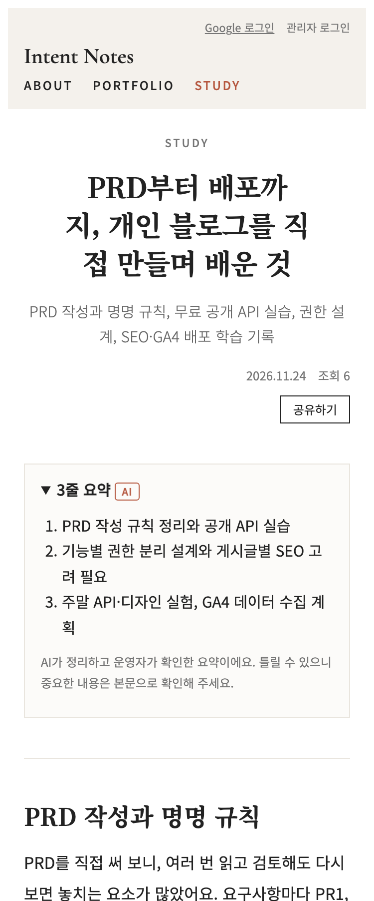 ⑦ 모바일 375px(홈·글)</td>
<td align="center" width="20%">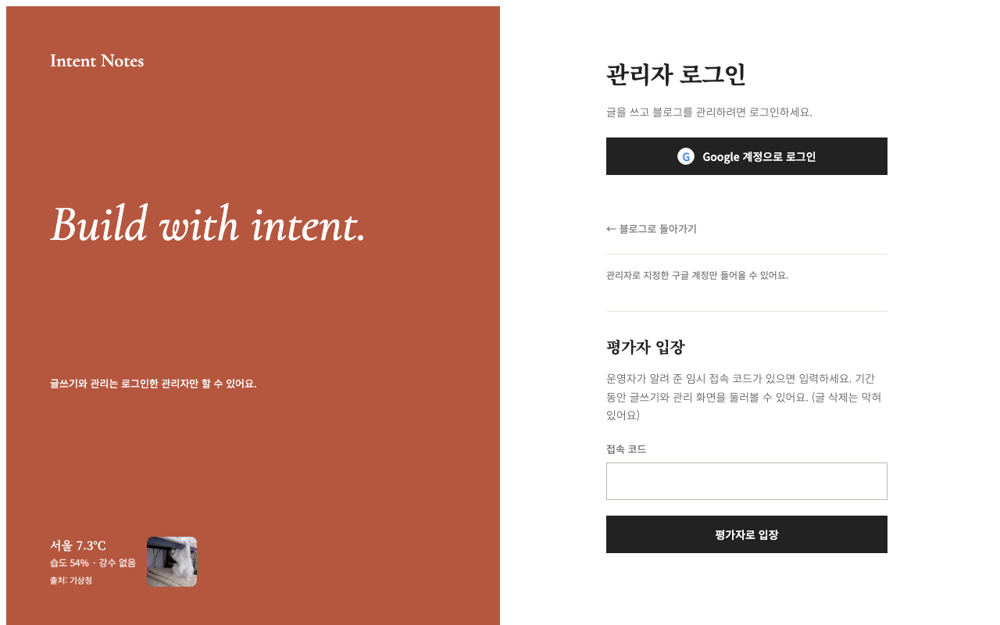 ⑧ 관리자 로그인</td>
<td align="center" width="20%">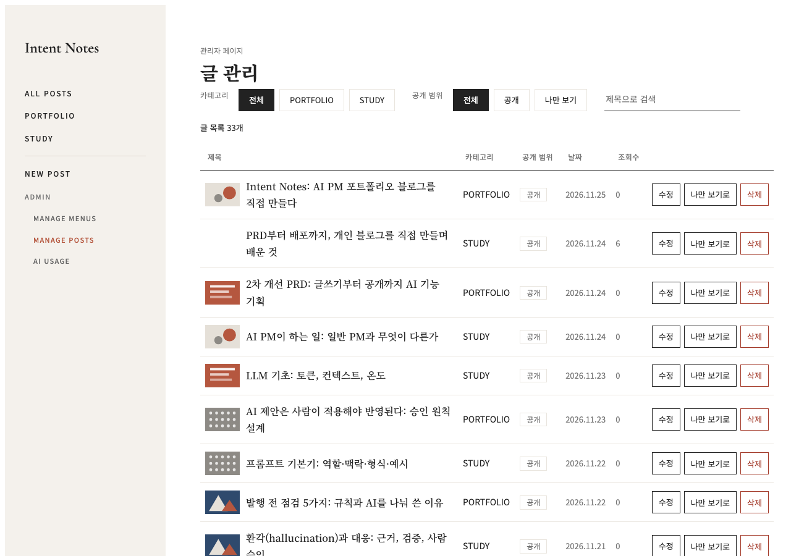 ⑨ 글 관리</td>
<td align="center" width="20%">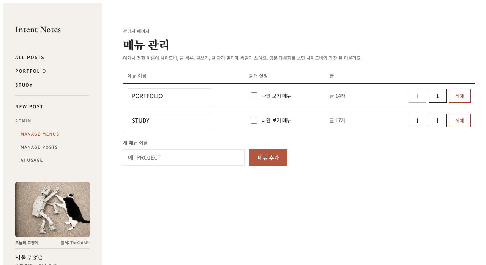 ⑩ 메뉴 관리</td>
</tr>
<tr>
<td align="center" width="20%">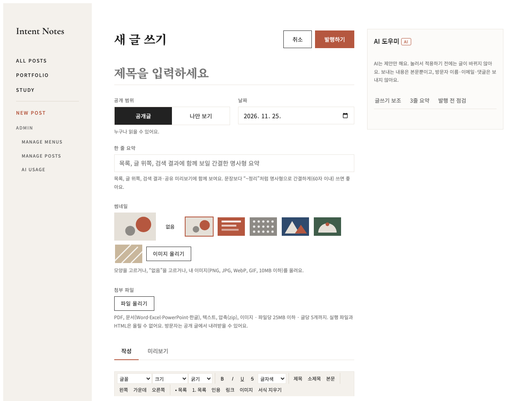 ⑪ 새 글·AI 도우미</td>
<td align="center" width="20%">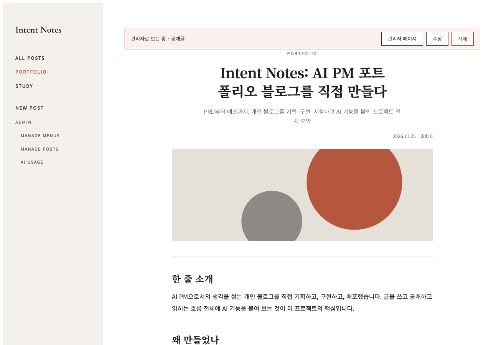 ⑫ 글 보기</td>
<td align="center" width="20%">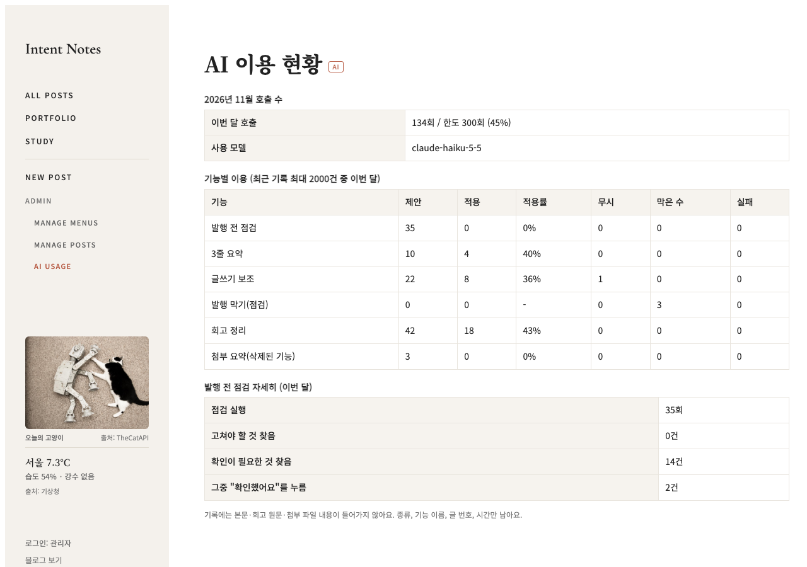 ⑬ AI 이용 현황</td>
<td colspan="2">관리자 화면(⑧~⑬)은 로그인한 상태의 화면을 그대로 그려 찍었습니다. <b>회고(나만 보기) 메뉴·글·메뉴 링크는 공개 저장소라서 지웠습니다.</b> 그래서 ⑨의 "글 목록 33개"에는 지운 글이 포함되어 있고 ⑩에는 메뉴 2개만 보입니다. 회고 정리 화면은 회고 글이 그대로 보여 넣지 않았습니다(열림과 375px 넘침 없음은 확인).</td>
</tr>
</table>

## 2. 기능별 단위테스트

표기: [사이트] 실제 사이트, [코드] 코드를 가짜 데이터로 실행, [로컬] 가짜 저장소·가짜 AI. 괄호는 부록의 항목 번호입니다.

| 기능 | 입력 → 기대 | 결과 | 판정 |
|---|---|---|---|
| 첫 화면·목록 (A1, A2) | 홈과 메뉴별 목록 열기 → 이름·소개·최근 글, 모든 글에 썸네일 | [사이트] 최근 글 5개, 글 31편(2편은 썸네일 "없음" 선택) | ✅ |
| 모바일 375px (A3, G1) | 목록·글·글쓰기를 375px로 열기 → 가로 스크롤 없음 | [사이트] 모두 넘침 없음, AI 버튼 48×48 | ✅ |
| 검색 노출 (A4) | 사이트맵·회고 주소 열기 → 공개 글만 | [사이트] 37주소에 회고·관리자 없음, 회고 주소 404 | ✅ |
| 3줄 요약 승인 (B1~B4) | 체크한 요약만 공개, 본문이 바뀌면 숨김 | [코드] 체크 안 한 요약은 비공개, 본문 변경 시 숨김 | ✅ |
| 추천 수량 (B5, B6) | 공개 글 4편부터 카드, 최대 3개 | [코드·사이트] 3편이면 없음, 31편 모두 최대 3개 | ✅ |
| 관련 없는 글 제외 (B7) | 다른 주제(김치찌개) 글에 카드 없음 | [코드] 처음 **실패**(카드 3개) → 흔한 말투 조각을 덜 세도록 고쳐 0개, 배포함 | ✅ |
| 추천 주제 일치 (B8) | 실제 글 4편의 카드가 주제상 이어짐 | [사이트] 3편 일치, 「모바일 관리자 화면」만 약함 | ⚠️ |
| 규칙 점검 (C1, C2, C4, C7) | 빈칸 표시·전화번호 찾기, 해결 필요는 발행 막음 | [코드] 12/12 일치, [사이트] 공개 37쪽에 0건 | ✅ |
| AI 점검 (C3, C5, C6) | 개인정보·내부 자료는 "확인 필요", 오탈자는 "수정 권장" | [사이트] 문제 12/12 찾음, 오탐 0/8 | ✅ |
| 점검 목록 갱신 (C8) | 전화번호를 지우면 "해결 필요"가 바로 사라짐 | [로컬] 계속 남음(발행 때는 다시 계산해 저장됨) | ❌ |
| 글쓰기 보조 (D1~D4) | 제안만 하고 [적용] 전에는 입력칸 그대로 | [사이트] 제목 후보 3개·한 줄 요약, 3줄 요약은 개조식 | ✅ |
| 회고 정리 (D5, E8) | 초안이 글쓰기로 넘어가고, 요약만 보내기 가능 | [로컬] 원문 0건 전송 확인 | ✅ |
| 요약 채움률 KR1 (D6) | 한 줄 요약 100% | [사이트] 29/31 = 93.5%(빈 2편은 기존 글, 그대로 두기로 함) | ⚠️ |
| 접근 제한 (E1) | 로그인 없음·가짜 토큰·비관리자 → 거부 | [사이트] 모두 403 | ✅ |
| 방문자 AI 미호출 KR4 (E2) | 방문자 화면에서 AI 호출 0 | [사이트] 37쪽·스크립트 5개·요청 30건 중 0건 | ✅ |
| 한도·실패 처리 (E3~E5) | 80%부터 알림, 한도에 닿으면 AI만 멈춤, AI 실패해도 발행 | [로컬] 83% 안내, 300/300에서 AI만 멈춤 | ✅ |
| 서버 쪽 확인 (C9, E10) | 화면을 우회한 저장 거부, 실제 300회 초과 → 429 | 규칙 파일의 패턴만 확인, 300회는 쓰지 않아 못 함 | ➖ |
| 이용 기록·처리방침 (E6, E7, E9) | 현황 표, 기록에 본문 없음, 처리방침에 AI 안내 | [사이트·코드] 모두 확인 | ✅ |
| 측정 이벤트 (F1, F2) | 누를 때만 이벤트 전송 | [사이트] 열기만 하면 0개, 누르면 전송, GA 도착 확인 | ✅ |
| 측정기준 값 (F3) | 등록한 8개 값이 보고서에 나타남 | 8개 등록 확인, 값 표시는 처리 시간이 필요해 못 봄 | ⚠️ |
| 읽기·공유·댓글 이벤트 (F4) | 코드에 이벤트가 있음 | 처음 **없음** → 구현·배포, 진행도·완독·공유·첨부 로직 시험 통과, GA 도착은 못 봄 | ⚠️ |
| 접근성 (G2, G3) | 버튼 이름 구분, 화면 낭독·사파리·엣지 | [사이트] 이름 구분됨 / 낭독·사파리·엣지는 환경 없음 | ✅ ➖ |

## 3. 남은 문제와 한계

- **C8 점검 목록 갱신 지연:** 본문을 고쳐도 목록이 바로 안 바뀝니다. 발행할 때 다시 계산해서 안전 문제는 아닙니다. 고치지 않았습니다.
- **F3·F4 GA 확인:** 방문자 브라우저로 글을 읽고 GA 실시간·탐색에서 값을 봐야 합니다. 링크 복사 성공과 댓글 이벤트는 시험하지 못했습니다.
- **KR3 AI 제안 적용률:** 사용 기간이 짧아 4주 뒤(2026-12-23) 확인합니다.
- **한계:** 샘플이 뚜렷한 예라 애매한 경우의 AI 점검 정확도는 모릅니다. 로컬 시험은 가짜 AI·가짜 저장소입니다. 부작용은 실제 AI 호출 4회와 시험용 익명 계정 1개(삭제함)뿐이고 저장된 글은 없습니다. 스크린샷은 GA 주소를 막고 찍었습니다.

## 4. 버전 이력

| 버전 | 커밋 | 바뀐 내용 |
|---|---|---|
| v1.0 | `39a435c` | 기획 의도 기준 시험 보고서 최초 작성(44개 항목) |
| v1.1 | `b2a44b6` | B7(관련 없는 글 추천) 원인을 고쳐 실패 3 → 2, 제목에 기준 PRD 표시 |
| v1.2 | `a3cb5b0` | B8(추천 주제 일치)을 배포 뒤 다시 읽음 |
| v1.3 | `19eadc6` | F4 이벤트 구현·배포, 실패 2 → 1, 부분 통과 3 → 4 |
| v2.0 | `16faea3` | 규칙에 맞춰 2페이지 이하로 줄이고 유저플로우 스크린샷 추가, 상세는 부록으로 분리 |
| v2.1 | 이 커밋 | 관리자 화면 스크린샷 5장 추가(회고 항목은 가림), 유저플로우 화면을 13칸으로 정리 |
